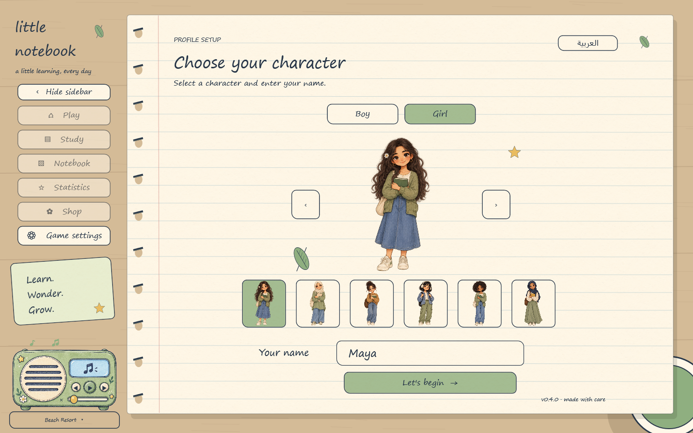
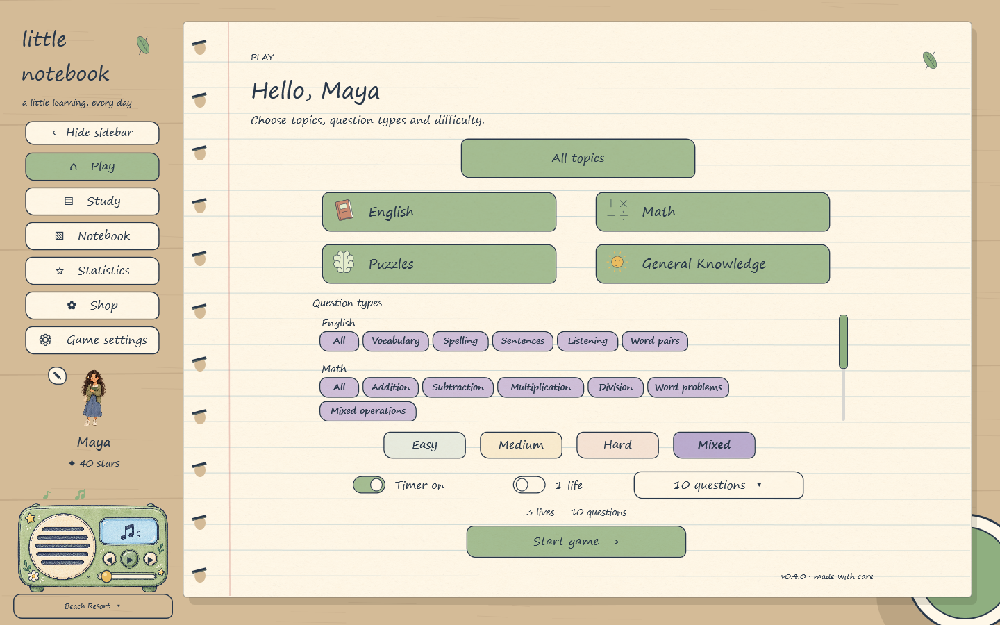
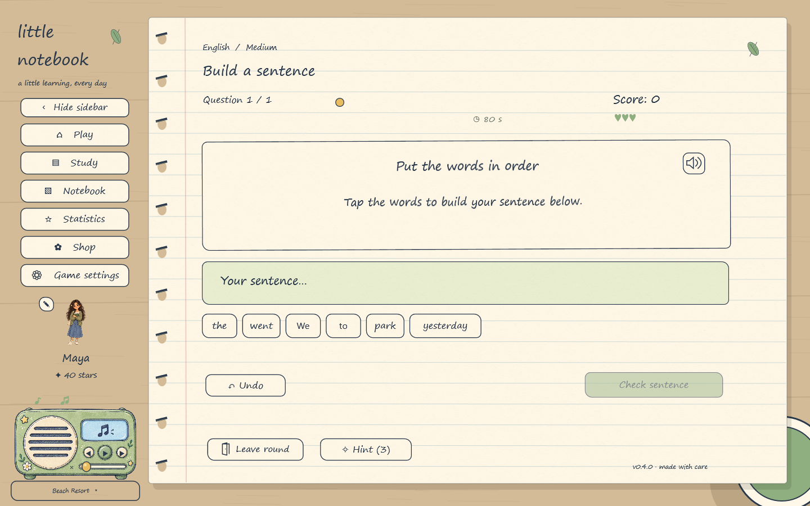
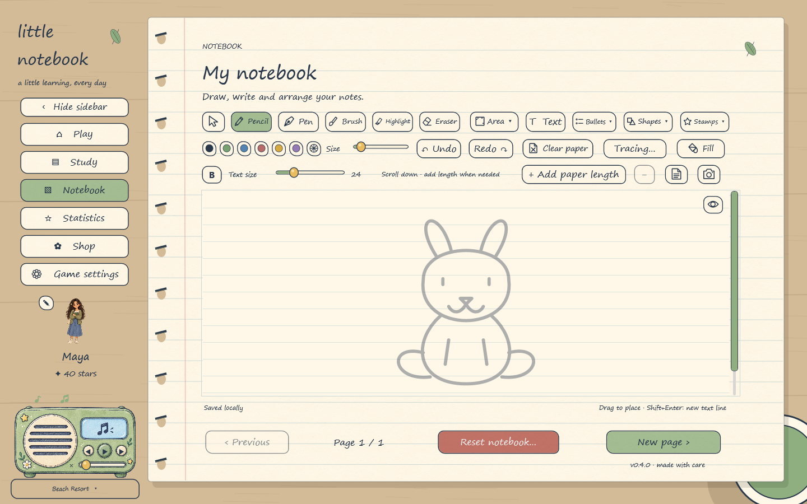

# Little Notebook

A cosy learning game for Windows, with a notebook to draw in and a little radio to keep you company.

Play English, maths, puzzles and general-knowledge questions. Choose your topics and difficulty, practise with English and Arabic speech, and review your mistakes at your own pace. Earn stars for characters, pets and decorations.

Between rounds, write or draw in your notebook, try tracing pictures, and listen to your own music. Import several music files together or add audio from a public YouTube/TikTok link.

## Install

[**Download Little Notebook for Windows**](https://github.com/farhanr3001/little-notebook-game/releases/latest)

Run the **LittleNotebook-Setup** installer from the latest release. Supports **64-bit Windows 10 and 11**, with **English and Arabic** interfaces. Required runtime components and offline voices are included; setup installs missing Microsoft prerequisites if needed.

The game checks for updates when opened. Updates keep your character, progress and notebook. You can also check manually in Game settings.

Music-link imports require an internet connection; availability depends on the source. [Asset and third-party credits](ASSETS.md).
